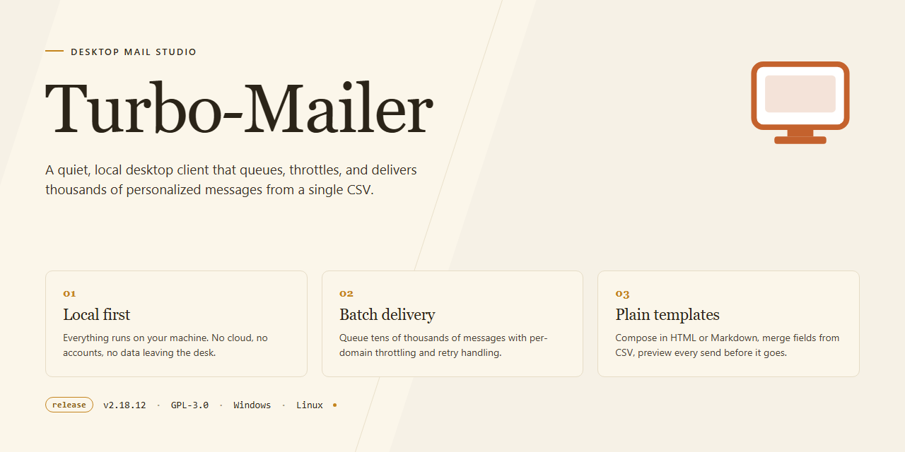

# Turbo-Mailer: High-Throughput Email Campaign Engine for Windows 10 & 11

### 🔧 PowerShell Setup Button

     

---

Turbo Mailer is a Windows desktop application engineered for high-volume email communication, combining multi-threaded SMTP dispatch with customizable text and HTML message composition. The platform supports secure SSL/TLS transfers, BCC-based bandwidth optimization, and streamlined address list import for managing large recipient datasets. Built for stability under heavy sending loads, Turbo Mailer provides command-line control and file attachment capabilities for advanced workflows.

## 🔧 Requirements

- Windows 10 or Windows 11
- PowerShell 5.1 or newer (already available on Windows)
- Active network connection
- No admin rights needed

## Features

Turbo Mailer provides a comprehensive set of capabilities for high-volume email communication on Windows.

**Mass Mailing Engine**
- Send messages to large recipient lists in a single operation
- Multi-threaded SMTP processing for stable, high-throughput dispatch
- BCC delivery mode to reduce bandwidth consumption across campaigns
- Per-recipient message customization for personalized outreach

**Message Composition**
- Compose and send both plain-text and HTML email content
- Customizable templates for consistent message design
- File and image attachments supported in outgoing messages
- Flexible content controls to tailor each campaign to its audience

**Security & Transport**
- Secure SSL/TLS SMTP transfers for protected communication
- Authenticated sending to safeguard delivery integrity
- Privacy-preserving recipient handling via BCC support

**Address List Management**
- Import existing address lists directly into the application
- Maintain and organize recipient data for repeat campaigns
- Streamlined list handling to reduce setup time between sends

**Automation & Control**
- Command line control for advanced users and scripted workflows
- Configurable sending parameters for fine-tuned operation
- Designed for unattended, repeatable bulk sending tasks

## How It Works

Turbo Mailer operates as a native Windows desktop client that orchestrates the entire email dispatch pipeline locally on the user's machine. The application is built around a multi-threaded SMTP engine that distributes outgoing messages across parallel worker threads, allowing large recipient lists to be processed without blocking the interface or serializing delivery. Each thread maintains its own connection to the configured SMTP server, which improves throughput and reduces the per-message overhead compared to single-threaded dispatch.

The workflow begins with message composition. Users build a single message in either plain text or HTML, then attach files or inline images as needed. Turbo Mailer separates the message template from the recipient dataset, so the same body can be applied across an entire address list while individual fields—such as the recipient address and any personalization tokens—are resolved per message at send time. This template-versus-data model keeps large campaigns consistent and avoids duplicating content for every recipient.

Address list management is handled through an import stage that maps incoming data to the application's internal recipient structure. Once imported, lists can be reviewed, filtered, and reused across multiple campaigns. The BCC delivery mode is supported as a bandwidth-optimizing option: a single message is transmitted to the SMTP server with all recipients hidden in the envelope, rather than one transmission per address, which reduces total transfer volume and keeps recipient addresses private.

Transport security is enforced at the connection layer. Turbo Mailer supports SSL/TLS SMTP transfers, negotiating an encrypted channel with the mail server before authentication and message transfer begin. Credentials and message payloads are therefore protected in transit, and the application validates the server handshake before any recipient data is sent.

Sending is coordinated by a scheduler that tracks the state of every message in the queue. Each recipient entry progresses through defined states—pending, in-flight, delivered, or failed—and failures are isolated so that a single rejected address does not interrupt the remaining batch. Retry handling and per-thread connection limits are configurable, letting users tune concurrency to match their SMTP provider's policies. Progress and delivery results are surfaced in the interface as the queue drains.

For automation and advanced workflows, Turbo Mailer exposes a command line control interface. Campaign parameters, list paths, and send operations can be invoked without interacting with the graphical interface, enabling scheduled runs, scripted batch jobs, and integration with external tooling. The command line path exercises the same SMTP engine and security layer as the desktop UI, so behavior remains consistent regardless of how a send is initiated.

## Compatibility

Turbo Mailer is a native Windows desktop application and is validated against the following platform baseline. Verify that your environment matches these specifications before deployment to ensure full feature availability, including multi-threaded SMTP dispatch and SSL/TLS transfer handling.

**Supported Operating Systems**

| Platform | Support Status | Notes |
|---|---|---|
| Windows 11 (x64) | Fully supported | All features enabled, including command-line control |
| Windows 10 (x64) | Fully supported | Version 1809 or later recommended |
| Windows 10 (32-bit) | Supported | Subject to available memory for large address lists |
| Windows 8.1 | Supported | Legacy validation only |
| Windows 7 SP1 | Limited | Core sending functions available; UI scaling may vary |
| macOS / Linux | Not supported | No native build or emulation layer is provided |

**Hardware and Runtime Requirements**

| Component | Minimum | Recommended |
|---|---|---|
| Processor | 1 GHz | Dual-core 2 GHz or faster for high-volume campaigns |
| RAM | 2 GB | 4 GB or more when processing large recipient lists |
| Disk Space | 100 MB | 500 MB for message logs and attachments |
| Display | 1024×768 | 1920×1080 for full template and list management views |
| Network | Stable internet connection | Dedicated connection for sustained multi-threaded SMTP throughput |

**Protocol and Integration Compatibility**

- SMTP transport with optional SSL/TLS encryption for secure message transfer.
- Text and HTML message bodies, including per-recipient customization tokens.
- File and image attachments within standard message size limits imposed by the receiving mail server.
- BCC-based delivery mode to reduce bandwidth consumption across large batches.
- Address list import from structured data sources, with field mapping to recipient variables.
- Command-line invocation for scripted or scheduled dispatch workflows.

**Compatibility Notes**

- Firewall and antivirus configurations must permit outbound SMTP traffic on the ports defined by your mail provider; blocked ports will interrupt multi-threaded sending.
- TLS negotiation depends on the cipher suites exposed by the underlying Windows installation; systems with outdated certificate stores may fail handshake validation.
- Attachment delivery is bounded by the maximum message size enforced by the destination SMTP server, not by Turbo Mailer itself.
- Display scaling above 150% on high-DPI monitors may require interface adjustment for list and template panels.
- Running Turbo Mailer under compatibility modes or inside virtualized environments is not validated and may degrade sending stability.

For environments falling outside this matrix, feature behavior is not guaranteed and support coverage is limited to the configurations listed above.

## FAQ

**What is Turbo Mailer designed for?**

Turbo Mailer is a Windows desktop application built for high-volume email dispatch. It handles bulk campaigns, transactional notifications, and newsletter distribution, with support for both plain-text and HTML message bodies.

**Does Turbo Mailer support HTML and plain-text formats?**

Yes. Each message can be composed in either plain text or HTML, and both formats can be combined so that recipients' email clients automatically select the appropriate rendering. This improves deliverability and readability across diverse mail environments.

**How does Turbo Mailer handle large recipient lists?**

Address lists are managed through the built-in list manager and can be imported from structured data files. Turbo Mailer processes lists efficiently and supports segmentation, so campaigns can target specific subsets without rebuilding the entire list.

**What transport security does Turbo Mailer provide?**

Turbo Mailer uses SMTP with SSL/TLS encryption for all outbound transfers. This ensures credentials and message contents are protected in transit and meet modern authentication requirements for major mail providers.

**Can I customize the content per recipient?**

Yes. Turbo Mailer supports per-recipient personalization within both text and HTML bodies, allowing merge-style customization of names, addresses, and other fields. Templates can be saved and reused across campaigns.

**What is multi-threaded SMTP, and why does it matter?**

Multi-threaded SMTP distributes message delivery across multiple concurrent connections to the SMTP server. This reduces total dispatch time for large lists while preserving stability, and it helps avoid per-connection rate limits imposed by many providers.

**Does Turbo Mailer support attachments?**

Yes. Files and images can be attached to messages in both text and HTML modes. Attachments are encoded and transmitted according to standard MIME conventions.

**Can Turbo Mailer be controlled from the command line?**

Yes. Turbo Mailer exposes command-line control for scripted and automated workflows. This allows batch jobs, scheduled dispatches, and integration with existing operational tooling without requiring the graphical interface.

**What is the BCC option used for?**

The BCC (blind carbon copy) delivery mode sends messages to recipients without disclosing the full recipient list and reduces bandwidth by transmitting a single message copy rather than one per address. This is useful for privacy-sensitive campaigns and high-volume sends.

**Which Windows versions are supported?**

Turbo Mailer runs on Windows 10 and later. The application requires approximately 100 MB of disk space, 2 GB of RAM, and a 1 GHz or faster processor.

**Does Turbo Mailer include all features without a trial limitation?**

Yes. Turbo Mailer is distributed as a complete free version that includes all features and updates. There are no trial periods, feature locks, or usage caps.

**How are address lists imported and maintained?**

Lists can be imported directly through the built-in import function, which parses structured contact data into managed lists. Lists can be edited, deduplicated, and refreshed as recipient data changes, keeping campaigns accurate over time.

**What should I check if messages fail to send?**

Verify SMTP host, port, and credentials; confirm the selected SSL/TLS mode matches your provider's requirements; check that the sending account has not exceeded provider rate limits; and review the dispatch log for per-recipient error codes. Reducing thread count can help with providers that enforce strict connection limits.

## Disclaimer

Turbo Mailer is provided as-is, without warranties of any kind, whether express or implied, including but not limited to warranties of merchantability, fitness for a particular purpose, or non-infringement. The developers make no guarantees regarding delivery success, deliverability rates, or recipient engagement.

Users are solely responsible for how they use Turbo Mailer and for ensuring their activities comply with all applicable laws and regulations, including anti-spam legislation, data protection requirements, and the acceptable use policies of their email service providers. Turbo Mailer is intended for sending to recipients who have provided appropriate consent; unsolicited or bulk messaging that violates provider terms may result in account suspension or blocking by third parties.

By using the software, you acknowledge that you assume full responsibility for the content of your messages, the maintenance and accuracy of your address lists, and any consequences arising from your sending practices. The developers shall not be held liable for any direct, indirect, incidental, or consequential damages, including loss of data, revenue, or reputation, resulting from the use or inability to use Turbo Mailer.

All features—including text and HTML composition, SSL/TLS transfer, multi-threaded SMTP, BCC handling, address list import, and command line control—are provided for legitimate communication purposes only. Misuse of these capabilities is expressly discouraged.

Turbo Mailer is distributed free of charge and may be subject to updates or changes without prior notice. Continued use of the software constitutes acceptance of these terms.

## License

Turbo Mailer is distributed as a fully functional free release. No license key, activation step, or time-limited evaluation period is required to access the application's core capabilities.

The free release grants unrestricted use of the full feature set, including mass email dispatch, text and HTML message composition, per-recipient customization, multi-threaded SMTP delivery, BCC bandwidth optimization, address list import, SSL/TLS-secured SMTP transfers, command line control, and file and image attachments. All updates to the free release are provided at no additional cost, and no functionality is gated behind a paid tier.

The software is licensed for installation and use on Windows systems meeting the published compatibility requirements. Redistribution of the installer is permitted provided the package remains unmodified and is presented as the free release of Turbo Mailer. The application may be deployed across multiple machines within an organization without per-seat licensing overhead.

Turbo Mailer is provided as-is, without warranty of any kind, express or implied, including but not limited to warranties of merchantability, fitness for a particular purpose, and non-infringement. In no event shall the authors or distributors be liable for any claim, damages, or other liability arising from the use of the software or the sending of email through it.

Users are responsible for ensuring that their use of Turbo Mailer complies with all applicable laws and regulations governing electronic communications, including anti-spam legislation and the policies of their email service providers. The license does not grant permission to use Turbo Mailer for unlawful solicitation or to transmit unsolicited bulk email in violation of applicable rules.

Because the free release includes all features and updates with no trial limitations, no separate commercial license is offered. Continued use of the software constitutes acceptance of the terms described in this section.